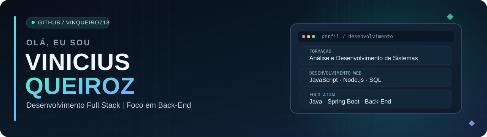

<!-- Perfil GitHub de Vinicius Queiroz | versão de apresentação -->
<!-- Identidade visual autoral: azul profundo, ciano e violeta. -->

  

 

  
  
  

### Um pouco sobre mim

Sou estudante de **Análise e Desenvolvimento de Sistemas na UNOESTE** e estou construindo minha trajetória na área de desenvolvimento de software, com interesse especial em **Back-End**.

Gosto de entender o que existe por trás de cada aplicação: desde as **regras de negócio e a modelagem do banco de dados** até a implementação da lógica, das APIs e da interface. É isso que venho colocando em prática nos projetos da faculdade e nos meus estudos.

Atualmente, aprofundo meus conhecimentos em **Java, Spring Boot e PostgreSQL**, sem deixar de desenvolver minha base em **JavaScript, Node.js e desenvolvimento web**. Meu objetivo é continuar aprendendo, transformar conhecimento em projetos e crescer como desenvolvedor.

> **Minha forma de aprender:** entender o problema, colocar a mão no código e melhorar a solução a cada versão.

---

### Tecnologias que já utilizo em estudos e projetos

  

### Meu foco de aprendizado atual

  

  Back-End com Java e Spring Boot • Banco de dados relacional • Evolução para React + TypeScript

---

### Projetos em destaque

<table>
  <tr>
    <td width="50%" valign="top">
      <h3>Corte Imperial — Projeto Integrador</h3>
      
Sistema acadêmico desenvolvido em equipe para apoiar a gestão e a comercialização de uma casa de carnes fictícia. A experiência envolve <strong>regras de negócio, modelagem de dados, arquitetura MVC</strong> e desenvolvimento de funcionalidades administrativas.

      
<strong>Tecnologias trabalhadas:</strong> Node.js, Express, EJS e MySQL.

      Projeto acadêmico em equipe • Repositório não divulgado publicamente
    </td>
    <td width="50%" valign="top">
      <h3><a href="https://github.com/VinQueiroz18/FITFORCE">FITFORCE</a></h3>
      
Projeto pessoal de uma plataforma para academia, utilizado como laboratório para evoluir minhas habilidades e experimentar novas tecnologias.

      
<strong>Versão disponível:</strong> HTML, CSS e uma estrutura inicial de Back-End em Node.js.

      
<strong>Evolução planejada:</strong> React, TypeScript, Java, Spring Boot e PostgreSQL.

      <a href="https://github.com/VinQueiroz18/FITFORCE"><strong>Explorar projeto →</strong></a>
    </td>
  </tr>
</table>

**Outros exercícios:** [Portfólio Dev](https://github.com/VinQueiroz18/Projeto-Portfolio-Dev) — desafio prático da Rocketseat com HTML e CSS.

### Além do código

Em 2026, participei do **ENEPE**, apresentando um relato de experiência sobre um projeto integrador desenvolvido durante a graduação. Foi uma oportunidade de compartilhar o processo de desenvolvimento — do levantamento do problema e das regras de negócio à construção da solução — e também de desenvolver minha comunicação.
